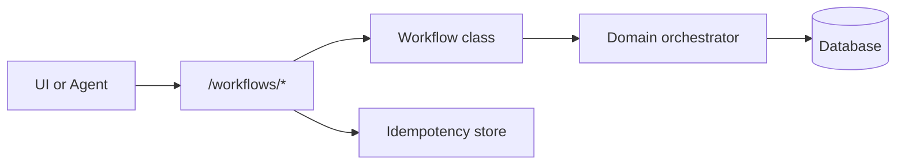

# Workflow desk cookbook

Generic pattern for **human-in-the-loop REST workflows**: multi-step server-side validation before commits, idempotent mutating steps, and the same orchestration layer for staff UI and agents.

This cookbook is **documentation only**. Implement workflows in your application repository.

## When to use

Use a workflow desk API when:

- User or agent actions span multiple steps (discover → validate → commit).
- Each step needs explicit server-side validation before mutating state.
- Idempotency keys protect commit endpoints from duplicate submits.
- Agents should call the same endpoints or orchestrators as the UI.

## Architecture



## Generic REST shape

Replace `{use_case}` with your domain (for example `onboarding`, `transfer`, `approval`):

| Phase | Endpoint | Purpose |
|-------|----------|---------|
| Start | `POST /workflows/{use_case}/start` | Open workflow, return session context |
| Discover | `POST /workflows/{use_case}/search` | Resolve candidates or options (read-only) |
| Validate | `POST /workflows/{use_case}/validate` | Run domain rules without commit |
| Commit | `POST /workflows/{use_case}/commit` | Mutate state; requires `Idempotency-Key` |
| Cancel | `POST /workflows/{use_case}/cancel` | Abort in-flight workflow |

Additional phases (approve, preview, etc.) follow the same thin-router + workflow-class pattern.

## Implementation checklist

1. **Workflow class per use case** — encapsulates steps; inject orchestrator and DB session.
2. **Thin router** — FastAPI routes delegate to workflow methods; no business logic in handlers.
3. **Pydantic schemas** — separate request/response models per step.
4. **Orchestrator injection** — `Depends(get_orchestrator)` keeps workflows testable.
5. **Idempotency on commits** — use `sqlalchemy-idempotency` with a stable scope key per commit route.
6. **RBAC at router** — enforce roles on the workflow router.
7. **Agent parity** — agent tools call the same workflow/orchestrator layer, not raw SQL.

## Minimal skeleton

```python
# workflows/router.py
router = APIRouter(prefix="/workflows", dependencies=[require_role("operator")])

@router.post("/example/start")
def start(body: StartRequest, wf: Annotated[ExampleWorkflow, Depends(get_workflow)]):
    return wf.start(body)

@router.post("/example/commit")
def commit(
    body: CommitRequest,
    wf: Annotated[ExampleWorkflow, Depends(get_workflow)],
    idempotency_key: Annotated[str | None, Header(alias="Idempotency-Key")] = None,
):
    return wf.commit(body, idempotency_key=idempotency_key)
```

```python
# workflows/example.py
class ExampleWorkflow:
    def __init__(self, session: Session, orchestrator: DomainOrchestrator) -> None:
        self._session = session
        self._orchestrator = orchestrator

    def start(self, body: StartRequest) -> StartResponse:
        ...

    def commit(self, body: CommitRequest, *, idempotency_key: str | None) -> CommitResponse:
        cached = find_cached_response(
            self._session,
            scope_key="workflows:example:commit",
            idempotency_key=idempotency_key,
            payload=body.model_dump(),
        )
        if cached:
            return CommitResponse(**cached[1])
        result = self._orchestrator.commit(...)
        store_response(...)
        return result
```

## Related packages

- [fastapi-platform-kit](../../packages/fastapi_platform/) — errors, JWT, health
- [sqlalchemy-idempotency](../../packages/sqlalchemy_idempotency/) — commit idempotency
- [agent-desk-starter](../../packages/agent_desk/) — LangGraph skeleton + desk session store

## Product-specific implementations

Concrete endpoint lists, orchestrators, and schemas belong in **consumer applications**. Document them under your app’s `docs/` (not in this monorepo).
