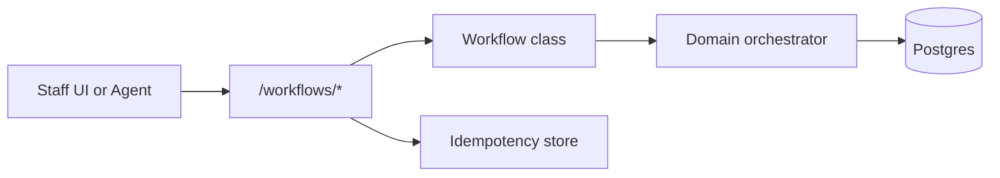

# Workflow desk cookbook

Pattern for **human-in-the-loop REST workflows** extracted from LMS-AI `src/lms/api/workflows/`.

## When to use

Use a workflow desk API when:

- Staff actions span multiple steps (search → validate → commit).
- Each step needs explicit server-side validation before mutating state.
- Idempotency keys protect commit endpoints from duplicate submits.
- An agent desk can call the same endpoints as the UI (shared orchestration).

## Architecture



## REST shape (LMS reference)

| Phase | Endpoint | Purpose |
|-------|----------|---------|
| Start | `POST /workflows/issue/start` | Open workflow, return session context |
| Search | `POST /workflows/issue/search-patrons` | Resolve patron candidates |
| Validate | `POST /workflows/issue/validate` | Run domain rules without commit |
| Commit | `POST /workflows/issue/commit` | Mutate state; requires `Idempotency-Key` |
| Cancel | `POST /workflows/issue/cancel` | Abort in-flight workflow |

Return flows mirror the same pattern under `/workflows/return/*`.

## Implementation checklist

1. **Workflow class per use case** — e.g. `SearchAndIssueWorkflow(session, orchestrator)`.
2. **Thin router** — FastAPI routes delegate to workflow methods; no business logic in handlers.
3. **Pydantic schemas** — separate request/response models per step (`IssueStartRequest`, etc.).
4. **Orchestrator injection** — `Depends(get_circulation_orchestrator)` keeps workflows testable.
5. **Idempotency on commits** — use `sqlalchemy-idempotency` with scope key `workflows:issue:commit`.
6. **RBAC at router** — `dependencies=[require_staff]` on the workflow router.
7. **Agent parity** — agent tools call the same workflow/orchestrator layer, not raw SQL.

## Minimal skeleton

```python
# workflows/router.py
router = APIRouter(prefix="/workflows", dependencies=[require_role("staff")])

@router.post("/example/start")
def start(body: StartRequest, wf: Annotated[ExampleWorkflow, Depends(get_workflow)]):
    return wf.start(body)

@router.post("/example/commit")
def commit(
    body: CommitRequest,
    wf: Annotated[ExampleWorkflow, Depends(get_workflow)],
    idempotency_key: Annotated[str | None, Header(alias="Idempotency-Key")] = None,
):
    return wf.commit(body, idempotency_key=idempotency_key)
```

```python
# workflows/example.py
class ExampleWorkflow:
    def __init__(self, session: Session, orchestrator: DomainOrchestrator) -> None:
        self._session = session
        self._orchestrator = orchestrator

    def start(self, body: StartRequest) -> StartResponse:
        ...

    def commit(self, body: CommitRequest, *, idempotency_key: str | None) -> CommitResponse:
        cached = find_cached_response(...)
        if cached:
            return CommitResponse(**cached[1])
        result = self._orchestrator.commit(...)
        store_response(...)
        return result
```

## LMS source map

| Cookbook concept | LMS path |
|------------------|----------|
| Router | `src/lms/api/workflows/router.py` |
| Issue workflow | `src/lms/api/workflows/search_and_issue.py` |
| Return workflow | `src/lms/api/workflows/return_book.py` |
| Schemas | `src/lms/api/workflows/schemas.py` |
| Orchestrator | `src/lms/loan/application/circulation_orchestrator.py` |

## Related packages

- [fastapi-platform-kit](../packages/fastapi_platform/) — errors, JWT, health
- [sqlalchemy-idempotency](../packages/sqlalchemy_idempotency/) — commit idempotency
- [agent-desk-starter](../packages/agent_desk/) — LangGraph + HITL session store
